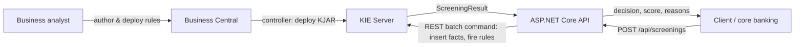

# KIE Transaction Screening

[](https://github.com/Al7assan1999/kie-transaction-screening/actions/workflows/ci.yml)

Screening bank transactions with a **business rules engine**: the rules are written in **Drools**, managed in **Business Central**, executed by **KIE Server**, and called from an **ASP.NET Core (.NET 10)** API.

Keeping rules outside the application means risk and compliance teams can change limits and thresholds in Business Central and redeploy them, without a code change or a release of the calling service.

## Architecture



| Part | Tech | Location |
|---|---|---|
| Rules (KJAR) | Drools 7.74 DRL, Java 11, Maven `kjar` packaging | [`rules/`](rules) |
| Rule authoring | Business Central workbench | `docker-compose.yml` |
| Rule execution | KIE Server (stateless session `screeningSession`) | `docker-compose.yml` |
| Screening API | ASP.NET Core minimal API, typed `HttpClient`, OpenAPI | [`src/Screening.Api/`](src/Screening.Api) |

## The rules

Defined in [`screening.drl`](rules/src/main/resources/com/alhassan/screening/screening.drl). Each rule can only **escalate** the decision (`APPROVE → REVIEW → REJECT`), so the order rules fire in never weakens a result. Every match adds to a risk score and records a reason.

| Rule | Condition | Decision | Score |
|---|---|---|---|
| Invalid amount | amount ≤ 0 | REJECT | 100 |
| Daily limit exceeded | daily total > 50,000 | REJECT | 50 |
| High-risk country | counterparty country in the policy list | REVIEW | 30 |
| High-risk customer with large amount | KYC risk = HIGH and amount > 10,000 | REVIEW | 25 |
| New account with large amount | account < 30 days old and amount > 5,000 | REVIEW | 20 |
| Cash reporting threshold | channel = CASH and amount ≥ 10,000 | REVIEW | 15 |

The high-risk country list isn't hard-coded in the rules. The API sends it with every request as a `ScreeningPolicy` fact (configured in `appsettings.json`), so it can change without redeploying the KJAR.

## How the API talks to KIE Server

One request = one call to KIE Server's batch-execution endpoint against a stateless session:

```http
POST /kie-server/services/rest/server/containers/instances/transaction-rules
X-KIE-ContentType: JSON
```
```json
{
  "lookup": "screeningSession",
  "commands": [
    { "insert": { "object": { "com.alhassan.screening.Transaction": { "id": "T1", "amount": 12000, "channel": "CASH", "...": "..." } } } },
    { "insert": { "object": { "com.alhassan.screening.ScreeningPolicy": { "highRiskCountries": ["AA", "BB"] } } } },
    { "insert": { "object": { "com.alhassan.screening.ScreeningResult": { "transactionId": "T1" } },
                  "out-identifier": "result", "return-object": true } },
    { "fire-all-rules": { "out-identifier": "firedRules" } }
  ]
}
```

The rules fill in the `ScreeningResult`, which comes back under `execution-results` and is mapped to the API response.

## API

| Method | Route | Description |
|---|---|---|
| `POST` | `/api/screenings` | Screen a transaction; returns decision, risk score and reasons |
| `GET` | `/api/rules/status` | 200 if the rules container is deployed and started on KIE Server |
| `GET` | `/openapi/v1.json` | OpenAPI document |

```bash
curl -X POST http://localhost:5080/api/screenings -H 'Content-Type: application/json' -d '{
  "id": "T1", "customerId": "C42", "amount": 12000, "currency": "USD", "channel": "CASH",
  "country": "US", "customerRiskLevel": "HIGH", "dailyTotal": 60000, "accountAgeDays": 400
}'
```
```json
{
  "transactionId": "T1",
  "decision": "REJECT",
  "riskScore": 90,
  "reasons": [
    "Daily limit of 50,000 exceeded",
    "High-risk customer sending more than 10,000",
    "Cash transaction at or above the 10,000 reporting threshold"
  ]
}
```

Input is validated before KIE Server is called (400 with field errors); if KIE Server is down or the container isn't deployed the API answers 503 instead of leaking the upstream error.

## Running it

### Full stack with Business Central

```bash
docker compose up
```

1. Open Business Central at http://localhost:8080/business-central (`admin` / `admin`). KIE Server registers itself under **Deploy → Execution Servers** once it has started.
2. **Design → Import Project**, paste this repository's URL and import `transaction-rules`.
3. Open the project and click **Deploy**. Business Central builds the KJAR and deploys it to KIE Server as container `transaction-rules_1.0.0`.
4. Call the API on http://localhost:5080 (see the example above). Edit a rule in Business Central, redeploy, and the API picks up the new behaviour with no restart.

### Rules and API only (no Business Central)

This is exactly what the CI pipeline does:

```bash
docker run -d --name kie -p 8180:8080 quay.io/kiegroup/kie-server-showcase:7.74.1.Final
mvn -f rules/pom.xml install
# copy the KJAR into KIE Server's Maven repo and create the container
docker exec kie mkdir -p /opt/jboss/.m2/repository/com/alhassan/transaction-rules/1.0.0
docker cp ~/.m2/repository/com/alhassan/transaction-rules/1.0.0/. kie:/opt/jboss/.m2/repository/com/alhassan/transaction-rules/1.0.0/
curl -u kieserver:kieserver1! -X PUT -H 'Content-Type: application/json' \
  -d '{"container-id":"transaction-rules","release-id":{"group-id":"com.alhassan","artifact-id":"transaction-rules","version":"1.0.0"}}' \
  http://localhost:8180/kie-server/services/rest/server/containers/transaction-rules

dotnet run --project src/Screening.Api
```

## Tests

| Suite | What it covers | Command |
|---|---|---|
| Rule tests (JUnit) | Each rule and how decisions combine, run in an embedded Drools session | `mvn -f rules/pom.xml verify` |
| API tests (xUnit) | Command building, response parsing, validation, error handling with a stubbed KIE Server | `dotnet test` |
| Integration (xUnit) | The deployed rules on a real KIE Server container | runs in CI; locally set `KIE_SERVER_URL` |

## License

MIT
